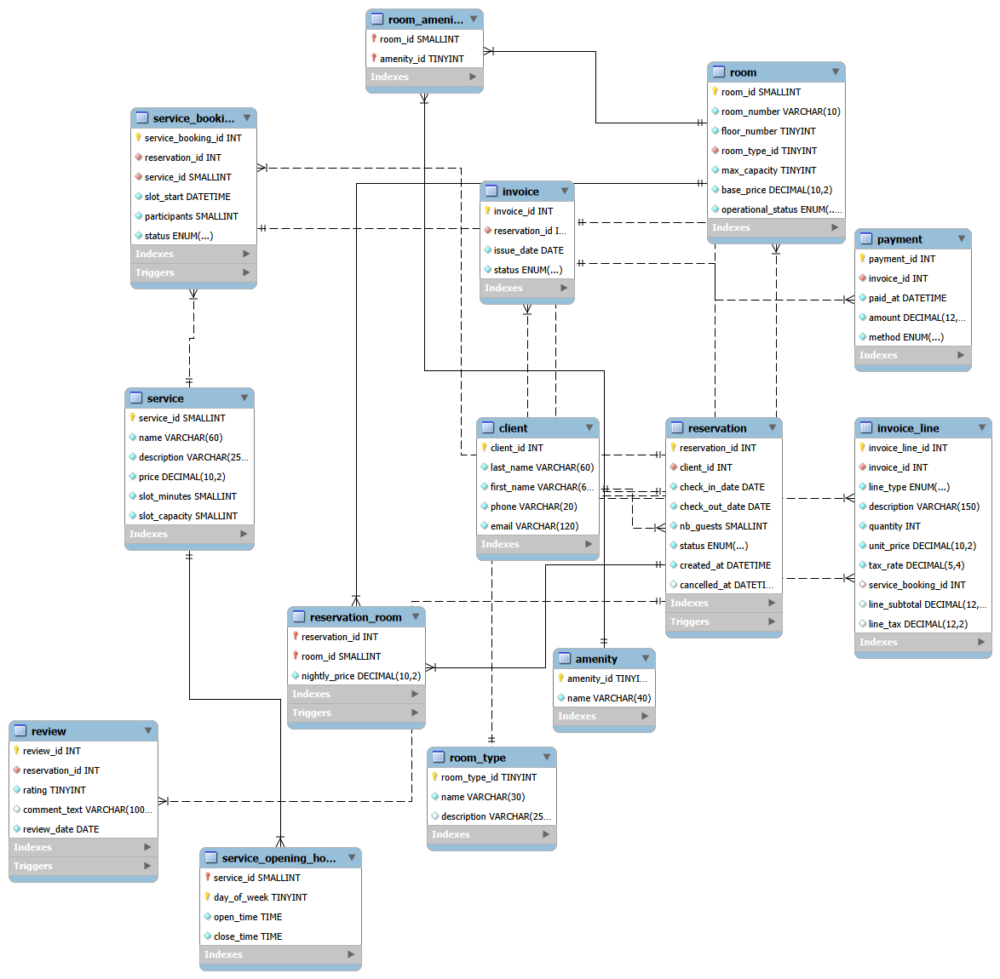

# Hotel Management database (MySQL 8 / InnoDB)

Individual project: design and implementation of a hotel database covering rooms, clients,
reservations, services, invoicing, payments and reviews (business rules BR-01 to BR-17).

**Author:** SURNAME Akiy Humphery &nbsp;|&nbsp; **Course:** Databases &nbsp;|&nbsp; **Engine:** MySQL 8.0, InnoDB

## Repository content

```
hotel-db/
├── README.md              this file: context, design choices, execution order
├── docs/
│   ├── erd.png            ERD exported from MySQL Workbench
│   └── data_dictionary.md every attribute: type, constraints, description, originating rule
└── sql/
    ├── 01_schema.sql      L3  tables, PK/FK (ON DELETE/UPDATE), UNIQUE, NOT NULL, CHECK, ENUM/lookups, views
    ├── 02_constraints.sql L4  triggers (BR-07, BR-12, ...) and procedures (payment, reservation)
    ├── 03_test_data.sql   L5  normal + edge case data set
    ├── 04_queries.sql     L6  the six analytical queries, commented
    └── 05_tests.sql       L5  violation attempts expected to fail (BR-05, BR-07, BR-16, ...)
```

## How to run

Requires MySQL 8.0+ (uses CHECK constraints, `JSON_TABLE`, recursive CTEs, `FOR SHARE`).
From the repository root, on an empty server, **in this order**:

```bash
mysql -u root -p < sql/01_schema.sql        # creates database hotel_db (drops it first if it exists)
mysql -u root -p < sql/02_constraints.sql
mysql -u root -p < sql/03_test_data.sql
mysql -u root -p -t < sql/04_queries.sql    # -t draws result tables
mysql -u root -p -t < sql/05_tests.sql      # prints PASS / FAIL for every violation attempt
```


## Design choices

### Business context
A hotel sells **rooms** (grouped by type, with amenities) to **clients** through **reservations**;
guests may use paid **services** (spa, restaurant...) during their stay; every reservation is
**invoiced** and settled by one or more **payments**; clients may leave one **review** per completed stay.
Currency is XAF (FCFA); VAT at 19.25 % is applied in the test data.

### Conceptual model (L2)



Structural choices

| Choice | Justification |
|---|---|
| `room_type` is a lookup **table**, statuses/payment methods are **ENUM** | The list of room types is open ("single, double, suite...", BR-01), carries a description and is used by queries 1 and 5; statuses and payment methods are small closed lists fixed by BR-03/06/14/15. |
| `reservation_room` associative entity carrying `nightly_price` | A reservation covers several rooms and a room is booked many times (BR-04); the price per room must be frozen at booking (BR-08), so it belongs to the link, not to `room`. |
| `check_in_date` / `check_out_date` stored on `reservation`, not per room | BR-04: all rooms of a reservation share the same dates. |
| `room.operational_status` is only informational; availability is computed | BR-03: availability over a period is derived from reservations (query 1), never from the status. |
| No reservation list or counters in `client` | BR-10: history is obtained by query (query 6). |
| `invoice_line` with `line_type`, generated `line_subtotal` / `line_tax`; totals are not stored | BR-13/BR-15: derived values cannot drift; the view `v_invoice_balance` computes totals, paid amount and balance. |
| `invoice.status` is stored | BR-15 requires a status that follows from the payments; it is maintained in one place (`sp_record_payment`) and checked by the audit view `v_invoice_status_audit`. |
| `service_opening_hours` (one interval per weekday) and `service.slot_minutes` | BR-11 needs hours for each day of the week and a capacity per time slot; a slot length is required to define what a slot is. A day without a row means closed. |
| `service_booking` is attached to a **reservation** | BR-12: a service can only be booked during the stay, so the booking must reference the stay (which gives the client). |
| Surrogate integer keys everywhere | Stable, compact foreign keys; natural keys (room number, e-mail) are kept `UNIQUE` instead. |

Relationships (cardinality parent : child, with justification)

| Relationship | Cardinality | Justification |
|---|---|---|
| ROOM_TYPE classifies ROOM | 1 : 0..N | Each room has exactly one type (BR-01); a type may have no room yet. |
| ROOM offers AMENITY (via ROOM_AMENITY) | N : N | BR-02: a room has several amenities and an amenity applies to several rooms; resolved by an associative table with a composite PK. |
| CLIENT makes RESERVATION | 1 : 0..N | BR-04: a reservation belongs to a single client; a client may have none (BR-10, test client 10). |
| RESERVATION covers ROOM (via RESERVATION_ROOM) | 1 : 1..N and 1 : 0..N | BR-04: one or more rooms per reservation; a room appears in many reservations over time (not simultaneously, BR-07). The minimum of one room is guaranteed by `sp_create_reservation` and the capacity audit (a reservation with no room would have 0 capacity). |
| RESERVATION includes SERVICE_BOOKING; SERVICE is booked as SERVICE_BOOKING | 1 : 0..N each | BR-12: a service booking links one stay to one service in one time slot; a stay may use several services. |
| SERVICE opens on days (SERVICE_OPENING_HOURS) | 1 : 0..7 | BR-11: opening hours for each weekday; at most one interval per weekday (composite PK). |
| RESERVATION gives rise to INVOICE | 1 : 0..1 | BR-13: a single invoice per reservation (`UNIQUE`); it is issued at the end of the stay, so a pending reservation has none yet. |
| INVOICE is made of INVOICE_LINE | 1 : 1..N | BR-13: an invoice is made up of lines. The minimum of one line is a business expectation: an invoice without lines has a zero total and cannot receive a payment. |
| SERVICE_BOOKING is billed by INVOICE_LINE | 0..1 : 0..1 | BR-13 ("services used"): a booking is billed at most once (`UNIQUE`), and a `service` line must point to a booking (CHECK). |
| INVOICE is settled by PAYMENT | 1 : 0..N | BR-14: several payments per invoice, none yet for a due invoice. |
| RESERVATION is reviewed in REVIEW | 1 : 0..1 | BR-16: at most one review per reservation (`UNIQUE`), only for a completed one (trigger). |

### Keys and ON DELETE / ON UPDATE policy (L3)
* `ON UPDATE CASCADE` on all foreign keys: keys are surrogate and never change, so it is a harmless safety net (one link uses `RESTRICT`, because MySQL forbids cascading actions on a column used in a CHECK).
* `ON DELETE RESTRICT` wherever deleting the parent would destroy history or accounting: client → reservation, room → reservation_room, room_type → room, reservation → invoice / review, service → service_booking, invoice → payment, service_booking → invoice_line. A client or room that has history is never deleted; cancel or deactivate instead (script 05 proves these deletions are refused).
* `ON DELETE CASCADE` only for rows that have no meaning without their owner: `room_amenity`, `reservation_room`, `service_booking` (owned by a reservation that has no invoice yet), `service_opening_hours`, `invoice_line` (part of the invoice document).

### Rules MySQL cannot declare (L4) and how they are enforced

| Rule | Enforcement |
|---|---|
| BR-05 dates | `CHECK (check_out_date > check_in_date)`. |
| BR-05 guests ≤ capacity | `sp_create_reservation` (atomic creation, checks before inserting), trigger `trg_reservation_bu` (guests/status changes), trigger on `reservation_room` deletion, plus audit view `v_reservation_capacity_audit`. MySQL has no deferred constraints, so a raw `INSERT` of a reservation followed by its rooms cannot be checked row by row; the procedure is the supported entry point and the audit view proves the data is clean. |
| **BR-07** no overlapping non-cancelled reservations on a room | Triggers `trg_reservation_room_bi` (new room line) and `trg_reservation_bu` (re-dating) via `sp_assert_room_free`. Overlap test: `a.in < b.out AND b.in < a.out` on the nights `[check-in, check-out)`, so back-to-back stays are allowed and **cancelled reservations are ignored (they free their rooms immediately)**. A cancelled reservation is terminal (cannot be reopened). |
| BR-08 frozen price | `nightly_price` copied from `room.base_price` at booking; a trigger forbids changing it; test 62 shows a catalogue price change leaves it untouched. |
| **BR-12** services | Triggers `trg_service_booking_bi/bu` via `sp_assert_service_slot`: reservation not cancelled; slot date between check-in and check-out day (both included, a guest may use the spa on departure day); service open that ISO weekday; whole slot inside the opening interval and on the slot grid starting at opening time; participants already booked + new ≤ slot capacity (cancelled bookings free their places). |
| **BR-15** payments | `sp_record_payment`: one transaction that locks the invoice, rejects non-positive amounts (BR-14) and overpayment, inserts the payment and updates the invoice status (`due` / `partially_paid` / `paid`). |
| BR-16 / BR-17 reviews | `UNIQUE (reservation_id)`, `CHECK rating BETWEEN 1 AND 5`, triggers `trg_review_bi/bu`: reservation must be `completed` and `review_date >= check_out_date`. |

Concurrency: the BR-07 and BR-12 triggers lock the room / service row (`SELECT ... FOR UPDATE`) and then read the
competing bookings with a locking read (`FOR SHARE`), which sees the latest committed data. This was verified with two
concurrent sessions (the second booking of the same room, or of the last spa place, waits and is then rejected).

Known limitations (documented on purpose)
* Direct `INSERT`s into `payment` bypass the status update: in production grant `EXECUTE` on `sp_record_payment` and no `INSERT` on `payment` (the audit view detects any drift).
* `sp_record_payment` / `sp_create_reservation` start their own transaction, which implicitly commits a transaction already open in the calling session.
* Nights available (query 2) assume a constant room inventory: the model keeps no history of operational status.

### Test data (L5, section 3.4)
15 rooms (4 types, room 404 out of service), 10 clients (client 10 has no reservation), 20 reservations
(13 completed, 3 confirmed, 2 pending, 2 cancelled; two multi-room), 4 services with opening hours that differ by
weekday (the spa is closed on Sunday), 13 invoices (7 paid, 3 partially paid, 3 due) with 12 payments, 7 reviews rated
5, 4, 5, 3, 1, 2, 4. Edge cases: back-to-back stays on the same room, a cancelled reservation and a confirmed one on
the same room and dates, guests equal to capacity, a frozen price lower than today's catalogue price, a service slot
filled exactly to capacity, a booking on check-out day, a review dated on the check-out day, a 0 % tax line, an invoice
settled by two payments. The data respects every constraint: it is loaded through the real triggers and payments go
through `sp_record_payment`.

### Analytical queries (L6)
1. rooms of a type available between two dates (two examples, based on reservations only, BR-03);
2. monthly occupancy = nights sold / nights available (recursive calendar, stays split across months);
3. monthly revenue split accommodation / services (+ miscellaneous), excluding VAT, by invoice month;
4. unpaid invoices with outstanding balance, oldest first;
5. average rating and number of reviews per room type (a review counts once per type);
6. top 5 clients by amount invoiced, with their number of completed stays.

Each query documents its assumptions in comments.

## Submission checklist
- [ ] repository public (or shared with the examiner), at least 5 commits (see `git log`)
- [ ] scripts 01 → 05 run without error on an empty database
- [ ] email the link to e.njifanda@commonfactor.tech, subject `[DB-Hotel] SURNAME Akiy Humphery`
